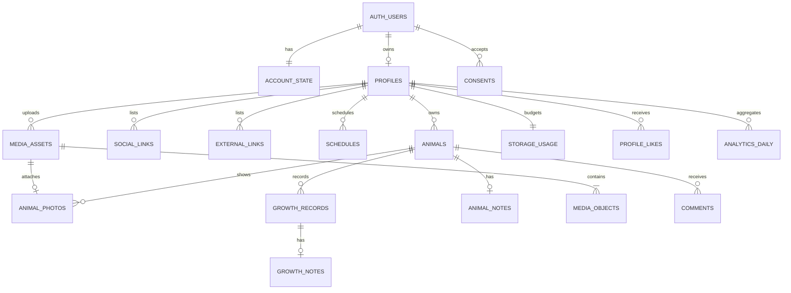

# 렙타일링크 데이터 구조 v0.1

상태: 논리·물리 설계 초안. **실행용 SQL이나 적용된 마이그레이션이 아니다.** 타입·키·제약·권한을 로컬 DB에서 검증한 다음 마이그레이션으로 구현한다.

관련 문서: [기능 명세](01-functional-spec.md), [무료 운영 계획](03-free-development-plan.md).

## 1. 설계 원칙

- PostgreSQL 사용. 인증 비밀번호·OAuth 토큰은 애플리케이션 테이블에 저장하지 않는다.
- 한 인증 사용자당 한 브리더 프로필. 프로필의 UUID는 사용자 UUID와 같다.
- 공개 테이블에는 외부에 보여도 되는 필드만 저장한다. 승인 상태·동의 내역·메모·파일 저장 경로·용량은 별도 비공개 스키마에 둔다.
- 모든 자식 데이터에 `profile_id`를 두고, 개체와 연결되는 행은 복합 외래 키로 동일 소유자를 강제한다.
- 파일 본문은 Storage, DB에는 파일 메타데이터만 저장한다. 서명 URL은 DB에 저장하지 않는다.
- 서버 저장은 즉시 현재 버전이다. 영구 임시저장 테이블·공개 스냅샷 테이블은 초기에는 만들지 않는다.
- 숫자·문자열·관계·소유권·할당량을 DB에서도 검증한다. UI 검증은 추가 안내다.
- 단계 A 테이블부터 구현하고 B/C 테이블은 해당 기능 착수 시 생성한다.

## 2. 관계 개요

인증 서비스의 내부 스키마는 변경하지 않으며 `auth.users`는 참조만 한다.

## 3. 스키마와 공통 규약

| 스키마 | 용도 | Data API 노출 |
|---|---|---|
| `public` | 프로필·개체 등 공개 가능한 행과 소유자 편집 데이터 | 필요한 테이블만 명시적으로 허용 |
| `private` | 계정 상태, 동의, 메모, 파일·할당량, 내부 알림·통계·신고 | 노출하지 않음 |
| `api` | 제한된 조회·저장 RPC | 필요한 함수만 노출, 실행 역할 명시 |
| `auth`, `storage` | 제공업체 관리 인증·파일 메타데이터 | 애플리케이션 임의 변경 금지 |

- `id uuid`: 서버/DB 생성 기본 키. 동의·집계·매핑 테이블은 설명한 복합 키 사용.
- `profile_id uuid`: `public.profiles(id)` 참조, 소유권 기준. 생성 이후 임의 변경 불가.
- `created_at`, `updated_at timestamptz`: 서버/DB가 UTC로 기록. 클라이언트 지정값을 신뢰하지 않는다.
- `date`: 시간대가 없는 날짜(생일·측정일). 이벤트 시각과 혼용하지 않는다.
- `sort_order integer`: 0 이상. 프로필 또는 개체 내에서 중복 불가. 순서 교체는 한 트랜잭션으로 수행한다.
- 문자 길이는 앞뒤 공백 정리 후 검사. UTF-8 바이트 수와 화면 글자 수의 차이를 고려한 입력 검증 함수를 공유한다.
- 필수 문자열은 `NOT NULL`과 빈 문자열 금지. 제한 값은 CHECK/허용 목록으로 구현한다.
- 모든 참조 FK는 삭제 정책을 명시하고 조회에 필요한 인덱스를 둔다. FK만으로 인덱스가 생성된다고 가정하지 않는다.
- 삭제 정책 기본: 프로필 하위의 도메인 행은 최종 삭제 시 CASCADE, 파일 레지스트리·사용량은 정리 완료 전 RESTRICT. 인증 계정 삭제는 정리의 마지막 단계다.

## 4. 단계 A: 계정·공개 페이지·개체

### 4.1 `private.account_state`

| 필드 | 타입·제약 | 의미 |
|---|---|---|
| `user_id` | uuid PK, FK auth.users | 인증 사용자 |
| `status` | text: pending/active/suspended/deleting | 가입 승인·이용 상태 |
| `approved_at` | timestamptz nullable | 운영자 승인 시각 |
| `suspended_at` | timestamptz nullable | 중지 시각 |
| `deletion_requested_at` | timestamptz nullable | 탈퇴 요청 시각 |
| `created_at`, `updated_at` | timestamptz | 시스템 시각 |

인증 사용자 생성 시 신뢰된 DB 트리거로 pending 행을 만든다. 사용자가 status를 INSERT/UPDATE하는 권한은 없다. 본인 상태 조회 RPC와 운영자 전용 상태 변경 작업을 분리한다. 모든 인증 쓰기는 현재 DB 상태가 active인지 다시 확인한다. 오래된 JWT의 역할 값만으로 허용하지 않는다.

연관된 초기 가입 제어 테이블 `private.signup_allowlist`는 `normalized_email text PK`, `expires_at timestamptz`, `revoked_at timestamptz nullable`, `created_at timestamptz`를 가진다. 이메일은 trim·소문자 정규화만 수행하고 점·플러스 부분을 임의로 지우지 않는다. 운영자만 쓰고 Auth 훅만 필요한 범위로 읽는다. 일반 회원·공개 API에는 노출하지 않는다. 초기에는 Google 로그인만 허용하고 다른 가입 경로를 활성화하지 않는다. 훅은 서버가 검증한 OAuth 흐름의 이메일을 비교하며 사용자 수정 메타데이터를 신원 증거로 쓰지 않는다. 탈퇴 시 해당 초대도 폐기하고 재가입에는 새 초대를 요구한다. 실제 로컬·원격 Auth 동작은 P0에서 검증한다.

### 4.2 `private.consents`

| 필드 | 타입·제약 | 의미 |
|---|---|---|
| `user_id` | uuid FK auth.users | 동의자 |
| `document_kind` | text: terms/privacy | 문서 종류 |
| `document_version` | text, 1~40자 | 실제 게시된 문서 버전 |
| `accepted_at` | timestamptz | 동의 기록 시각 |

PK `(user_id, document_kind, document_version)`. 현재 필수 버전이 동의되어야 온보딩·공개 가능. 사용자 임의 시각 수정·타인 동의 기록 생성은 금지. 마케팅 동의를 초기에는 수집하지 않는다.

### 4.3 `public.profiles`

| 필드 | 타입·제약 | 의미 |
|---|---|---|
| `id` | uuid PK, FK auth.users | 소유자이자 프로필 식별자 |
| `slug` | text UNIQUE, 3~30자 | 공개 주소 |
| `display_name` | text, 1~40자 | 공개 이름 |
| `tagline` | text, 최대 80자 | 한 줄 소개 |
| `bio` | text, 최대 300자 | 소개 |
| `theme_token` | text, 허용 목록 | 디자인 색상 |
| `avatar_asset_id` | uuid nullable, 소유자 일치 FK | 프로필 이미지 |
| `cover_asset_id` | uuid nullable, 소유자 일치 FK | 배경 이미지 |
| `is_published` | boolean, 기본 false | 공개 여부 |
| `first_published_at` | timestamptz nullable | 최초 공개 시각·주소 고정 기준 |
| `revision` | bigint, 기본 0, 단조 증가 | 소유자 편집 충돌 검사 |
| `created_at`, `updated_at` | timestamptz | 시스템 시각 |

slug 정규식은 `^[a-z0-9](?:[a-z0-9-]{1,28}[a-z0-9])$`. 저장 전 소문자로 정규화하고 예약어(`admin`, `api`, `auth`, `dashboard`, `help`, `terms`, `privacy`, `support`, `www`)를 거절한다. 최초 공개 후 slug 변경은 DB에서도 거절한다.

프로필과 파일 FK의 순환은 이미지 ID가 NULL인 프로필을 먼저 생성하고 업로드 후 연결해 해결한다. `(asset_id, profile_id)` 소유권뿐 아니라 avatar/cover 용도와 ready 상태를 검사한다.

### 4.4 `public.animals`

| 필드 | 타입·제약 | 의미 |
|---|---|---|
| `id` | uuid PK | 개체 |
| `profile_id` | uuid FK profiles | 소유자 |
| `name` | text, 1~40자 | 이름 |
| `species` | text, 1~80자 | 종류 |
| `morph` | text, 최대 120자 | 모프 |
| `sex` | text: unknown/male/female | 성별 |
| `birth_date` | date nullable | 생일, 저장 시 미래 날짜 거절 |
| `description` | text, 최대 500자 | 공개 설명 |
| `listing_status` | text: not_listed/available/reserved/rehomed | 분양 표시 |
| `is_public` | boolean, 기본 false | 개체 공개 |
| `show_growth` | boolean, 기본 false | 성장 수치 공개 |
| `sort_order` | integer | 카드 순서 |
| `created_at`, `updated_at` | timestamptz | 시스템 시각 |

UNIQUE `(id, profile_id)`, UNIQUE `(profile_id, sort_order)`(정렬 교체를 고려해 지연 검사 가능하게 구현). 종류·모프는 초기에는 사용자 텍스트다. 별도의 공식 종 분류 DB를 임의로 만들지 않는다.

이슈 #3의 일반 수정 명령은 `api.update_animal(p_animal_id, p_data, p_expected, p_request_id)`다. `p_data`에는 이름·종류·모프·성별·birth_date·설명·분양 상태 7개 필드를 모두 보내며 다른 필드는 거절한다. 공개 여부·소유자·사진·성장 공개·정렬은 변경하지 않는다. 생일은 `YYYY-MM-DD` 또는 NULL이며 실제 달력 날짜·서기 0001-01-01 이후·Asia/Seoul 오늘까지 허용한다. 트리거도 미래/무한 날짜를 거절한다. 이름/종류 필수·문자 길이·enum·JSON 자료형을 DB에서도 검사한다. 일반 수정의 Unicode 길이는 PostgreSQL과 같은 코드 포인트 기준이다.

활성 계정·현재 필수 동의·쓰기 허용·소유권을 확인하고 프로필 잠금 아래 요청 영수증 → 버전 검사 → 필드 갱신·revision 증가·영수증 저장을 처리한다. 요청 해시에는 대상 개체 ID와 본문을 함께 넣는다. 같은 요청 ID의 본문/대상/명령 변경은 `REQUEST_CONFLICT`, 만료된 영수증 재사용은 `REQUEST_EXPIRED`로 거절한다. 현재 동의 버전은 기존 로컬 구현과 같은 `local-preview-v1`이며 운영 정책 완료를 뜻하지 않는다. 직접 테이블 UPDATE는 계속 금지한다.

관리 DTO는 nullable 생일을 포함하며 공개 `public_page`는 명시적 허용 필드 목록에만 생일을 추가한다. 생일은 공개 개체 정보이며 비공개 관리 메모와 분리한다. Worker의 기존 bootstrap이 이 허용 DTO를 사용하므로 별도 특권 조회나 사진 경로를 추가하지 않는다.

### 4.5 `private.animal_notes`

`animal_id uuid PK`, `profile_id uuid`, `body text ≤ 2,000자`, `updated_at timestamptz`.

복합 FK `(animal_id, profile_id) → animals(id, profile_id) ON DELETE CASCADE`. 소유자 전용. 공개 설명과 같은 응답 객체에 넣었다가 프런트엔드에서 숨기는 방식을 사용하지 않는다.

### 4.6 `private.media_assets`

사진 한 장 또는 프로필·배경 이미지 한 개의 논리 레코드. 하나의 asset이 여러 변형 object를 가진다.

| 필드 | 타입·제약 | 의미 |
|---|---|---|
| `id` | uuid PK | 업로드 세트 식별자 |
| `profile_id` | uuid FK profiles, 최종 정리 전 RESTRICT | 소유자 |
| `animal_id` | uuid nullable, 소유자 일치 FK | 개체 사진일 때 대상 |
| `purpose` | text: avatar/cover/animal | 용도 |
| `state` | text: reserved/ready/delete_pending | 수명 주기 |
| `reservation_bytes` | bigint ≥ 0 | 업로드 전 최대 예약 바이트 |
| `actual_bytes` | bigint ≥ 0 | 모든 변형의 확인된 바이트 |
| `expires_at` | timestamptz nullable | 연결되지 않은 예약 만료 시각 |
| `verified_at` | timestamptz nullable | 신뢰된 검증 완료 |
| `created_at`, `updated_at` | timestamptz | 시스템 시각 |

UNIQUE `(id, profile_id)`. animal 용도는 animal_id 필수, 나머지는 NULL. ready에는 verified_at과 완성된 변형이 필요하다. 업로드 준비 중·삭제 대기 중인 asset을 콘텐츠에 새로 연결할 수 없다. 계정당 동시 예약은 최대 2세트다.

### 4.7 `private.media_objects`

| 필드 | 타입·제약 | 의미 |
|---|---|---|
| `id` | uuid PK | 실제 파일 레코드 |
| `asset_id`, `profile_id` | uuid, asset 소유자 일치 FK | 논리 이미지 |
| `variant` | text: original_display/thumbnail | 표시용 또는 카드용; 촬영 원본은 아님 |
| `object_path` | text UNIQUE | 무작위 버전 경로, 외부 DTO에서 제외 |
| `mime_type` | image/jpeg 또는 image/webp | 검증된 형식 |
| `byte_size` | bigint, 0 초과 | 확인된 크기 |
| `width`, `height` | integer, 0 초과 | 확인된 가로·세로 |
| `sha256` | text, 64자리 hex | 완성된 파일 무결성 값 |
| `state` | text: reserved/stored/delete_pending | 물리 파일 상태 |
| `created_at` | timestamptz | 시스템 시각 |

UNIQUE `(asset_id, variant)`. 파일 경로는 `{profile_uuid}/{asset_uuid}/{random_uuid}.{jpg|webp}` 형태. 사용자 파일 이름·이메일·개체 이름은 경로에 넣지 않는다. 파일 교체는 기존 경로 덮어쓰기 대신 새 asset·경로를 만든다.

### 4.8 `public.animal_photos`

`id uuid PK`, `profile_id uuid`, `animal_id uuid`, `asset_id uuid UNIQUE`, `sort_order integer`, `created_at timestamptz`.

- 복합 FK로 animal·asset 양쪽 소유자 일치.
- UNIQUE `(animal_id, sort_order)`. 정렬 첫 사진이 대표 사진이므로 별도의 중복 대표 상태를 만들지 않는다.
- 검증된 ready asset만 연결, 용도는 animal, asset.animal_id도 동일.
- 공개 사진 응답은 asset ID와 표시용 API 경로만 제공한다. private 메타데이터를 조인해 통째로 반환하지 않는다.
- 원본 개체 최종 삭제 시 사진 관계는 삭제하지만 asset 삭제는 외부 Storage 정리와 조율한다.

### 4.9 `private.storage_usage`

`profile_id uuid PK`, `reserved_bytes bigint`, `stored_bytes bigint`, `limit_bytes bigint`(기본 20MiB), `updated_at timestamptz`.

모든 숫자는 0 이상, `reserved_bytes + stored_bytes ≤ limit_bytes`. 삭제 대기 파일도 실제 제거 전 stored_bytes에 포함한다. 사용자에게 읽기 DTO만 제공하며 직접 수정 권한은 없다. 카운터 변경과 예약 행 변경은 같은 트랜잭션이다.

### 4.10 `private.project_budget`

프로젝트당 한 행: `id smallint PK CHECK(id=1)`, `media_limit_bytes bigint`, `media_reserved_bytes bigint`, `media_stored_bytes bigint`, `profile_limit integer`(제안 10), `admission_open boolean`, `writes_enabled boolean`, `updated_at timestamptz`.

미디어 내부 상한은 700MiB로 제안한다. Free 1GB와 동일한 단위라고 가정하지 않고 충분한 여유를 둔다. 이 행은 앱이 관리하는 저장량만 추적하며 제공업체의 실제 사용량·전송량을 대체하지 않는다. 운영자만 설정을 변경한다. profile_limit은 비공개·중지·탈퇴 정리 중인 것을 포함한 모든 미삭제 프로필 수에 적용한다. 중지로 슬롯을 무제한 재활용하지 않는다. writes_enabled=false여도 비공개 전환·탈퇴·용량 정리를 위한 제한된 삭제 경로는 허용한다.

### 4.11 `private.mutation_receipts`

`actor_id uuid`, `request_id uuid`, `operation text`, `request_hash text`, `result_ref jsonb`, `created_at timestamptz`, `expires_at timestamptz`.

PK `(actor_id, request_id)`. 변경 명령의 재전송을 24시간 동안 중복 처리하지 않는다. 같은 키·다른 본문은 거절. 저장 결과와 영수증 생성은 같은 트랜잭션. result_ref에는 ID·revision만 저장하고 댓글 본문·메모·토큰·서명 URL을 넣지 않는다. 만료 이후 오래된 명령을 무조건 자동 재전송하지 않는다.

## 5. 단계 B: 기록·링크·일정

### 5.1 `public.growth_records`

`id uuid PK`, `profile_id uuid`, `animal_id uuid`, `measured_on date`, `weight_g numeric(8,2)`, `created_at timestamptz`, `updated_at timestamptz`.

- 복합 FK `(animal_id, profile_id) → animals(id, profile_id)`.
- UNIQUE `(animal_id, measured_on)`. 무게는 `0 < weight_g ≤ 100000`.
- 저장 시 Asia/Seoul 현재 날짜 이후 거절. DB CHECK에 시간 변화에 의존하는 조건을 두기보다는 쓰기 함수에서 검증한다.
- 공개 조회 조건은 account active + profile published + animal public + show_growth.
- 기록 누락 날짜를 DB에 생성하지 않는다. 단위는 g로 고정한다.

### 5.2 `private.growth_notes`

`record_id uuid PK`, `profile_id uuid`, `body text ≤ 1,000자`, `updated_at timestamptz`.

`growth_records`에 `(id, profile_id)` UNIQUE를 추가하고 동일 소유자 복합 FK로 연결. 해당 기록 삭제 시 CASCADE. 공개 그래프·기록 조회에서 분리한다.

### 5.3 `public.social_links`

`id uuid PK`, `profile_id uuid`, `platform text`, `url text ≤ 2048자`, `is_public boolean`(기본 false), `sort_order integer`, `created_at`, `updated_at`.

platform 허용 목록은 기능 명세 F-02. UNIQUE `(profile_id, platform)`, UNIQUE `(profile_id, sort_order)`. URL은 HTTPS·자격증명 없음 규칙을 공유한다. 서버에서는 이 URL을 fetch하지 않는다.

### 5.4 `public.external_links`

`id uuid PK`, `profile_id uuid`, `title text 1~40자`, `url text ≤ 2048자`, `color_token text`, `is_public boolean`(기본 false), `sort_order integer`, `created_at`, `updated_at`.

UNIQUE `(profile_id, sort_order)`. 토큰은 허용 목록만. URL이 같아도 제목이 다른 링크는 허용한다. 10개 제한은 동시 쓰기를 고려해 DB에서 강제한다.

### 5.5 `public.schedules`

`id uuid PK`, `profile_id uuid`, `title text 1~80자`, `description text ≤ 300자`, `starts_at timestamptz nullable`, `ends_at timestamptz nullable`, `is_always boolean`(기본 false), `is_closed boolean`(기본 false), `is_public boolean`(기본 false), `sort_order integer`, `created_at`, `updated_at`.

- CHECK: is_always면 starts_at/ends_at 모두 NULL. 아니면 둘 다 필수이며 ends_at > starts_at.
- UNIQUE `(profile_id, sort_order)`.
- `status`는 저장하지 않는다. 기능 명세 F-06의 우선순위와 서버 시각으로 계산한다.
- 분양 상태·인증 상태와 같은 enum을 공유하지 않는다.

## 6. 단계 C: 반응·신고·통계

### 6.1 `public.comments`

`id uuid PK`, `profile_id uuid`(대상 페이지), `animal_id uuid`, `author_id uuid FK auth.users`, `body text nullable`, `status text visible/hidden/deleted`, `created_at`, `updated_at`, `deleted_at timestamptz nullable`.

- 대상 animal·profile은 복합 FK 일치. 작성자는 온보딩을 마친 active 회원.
- visible/hidden이면 body 1~500자, deleted이면 body=NULL·deleted_at 필수. 삭제는 내용부터 제거하고 최소 식별 행은 최대 7일 후 정리한다.
- 공개 조회는 visible + 상위 공개 조건. 작성자는 본인 행, 페이지 소유자는 자기 개체의 관리 목록을 조회할 수 있다.
- 작성자는 삭제만, 페이지 소유자는 숨김 상태만 변경. 작성자·대상·생성 시각 변경 금지. 일반 사용자의 댓글 본문 UPDATE는 허용하지 않는다.
- 작성자의 프로필이 공개된 경우에만 공개 이름·프로필 링크를 조인한다. 미공개면 ‘회원’ 표시. 승인 상태·이메일은 반환하지 않는다.
- 개체당 200개 제한은 보관 중인 hidden/deleted 행도 포함해 서버에서 강제한다.

### 6.2 `private.profile_likes`

`id uuid PK`, `profile_id uuid`(대상), `actor_id uuid FK auth.users`, `created_at timestamptz`.

UNIQUE `(profile_id, actor_id)`, CHECK(profile_id <> actor_id). INSERT/DELETE는 본인만, active 회원·공개 대상 조건. 공개에는 개수와 자기 좋아요 여부만 반환한다. 페이지 소유자에게만 허용된 좋아요 회원 목록을 제공한다. 추가·취소 합계 시간당 60회 제한을 적용한다.

### 6.3 `private.notifications`

`id uuid PK`, `recipient_id uuid FK profiles`, `kind text comment/profile_like`, `comment_id uuid nullable`, `like_id uuid nullable`, `created_at timestamptz`, `read_at timestamptz nullable`.

- kind와 연결 ID의 일치를 CHECK. comment_id/like_id 각각 UNIQUE, FK는 ON DELETE CASCADE.
- 댓글·좋아요 생성과 알림 생성은 같은 트랜잭션. 자기 행동에는 알림 생성하지 않는다.
- 읽기는 수신자만. read_at만 본인이 변경 가능. 본문·개체 사진을 알림 테이블에 복제하지 않는다.
- 숨김·비공개가 된 대상의 알림 DTO에는 원문을 노출하지 않는다. 90일 후 정리한다.

### 6.4 `private.content_reports`

`id uuid PK`, `reporter_id uuid FK auth.users`, `profile_id uuid`(대상 페이지), `animal_id uuid nullable`, `comment_id uuid nullable`, `reason text`, `detail text ≤ 500자`, `status text open/resolved`, `created_at`, `resolved_at timestamptz nullable`.

animal/comment 중 정확히 하나를 지정하며 대상 페이지와 일치해야 한다. 신고자는 active 회원. 사유 코드는 spam/abuse/privacy/other. 본인 접수 확인용 ID만 반환하고 신고 목록은 운영자만 읽는다. 회원별 일 5건 제한, 처리 완료 후 90일 이내 정리.

### 6.5 `private.analytics_daily`

`profile_id uuid`, `day date`, `page_views bigint ≥ 0`, `updated_at timestamptz`. PK `(profile_id, day)`.

Asia/Seoul 날짜, 페이지 조회수만 집계. 프로필 소유자는 일·주·월 합계 조회, 외부 공개 없음. 기본 보관 기간 365일. 보관 기간 밖 누적은 별도 프로필별 총계 행(`private.analytics_totals`: profile_id PK, page_views bigint)으로 유지한다. 총계와 일별 수치를 같은 트랜잭션에서 증가시키며, 기간 삭제 때 총계에서 차감하지 않는다.

### 6.6 `private.analytics_receipts`

`profile_id uuid`, `day date`, `session_hash text`, `created_at timestamptz`, `expires_at timestamptz`.

PK `(profile_id, day, session_hash)`. 비밀값·프로필·날짜를 포함한 서버 HMAC으로 생성하고 원문 세션 값은 저장하지 않는다. 최대 48시간 보관. 성공적인 신규 영수증 INSERT일 때만 일별·총계를 증가시킨다. 직접 DB INSERT 권한은 없고 제한된 수집 경로만 쓴다. 가짜 세션 생성까지 막는 사람 수 측정 장치로 간주하지 않는다.

### 6.7 `private.action_buckets`

`actor_id uuid`, `action text`, `window_started_at timestamptz`, `window_seconds integer`, `count integer`, `expires_at timestamptz`.

PK `(actor_id, action, window_started_at, window_seconds)`. 댓글·좋아요·신고 쓰기의 계정별 제한을 DB에서 원자적으로 증가·검사한다. 사용자 변경 금지. 고정 시간 창 경계의 순간 버스트 가능성을 인정하고 API의 추가 단기 제한을 함께 검증한다. 만료 행은 48시간 이내 정리한다. 익명 조회 남용 방어는 이 테이블에 IP별 행을 무한 생성하는 방식으로 구현하지 않는다.

## 7. 소유권·공개 권한

| 데이터 | 비로그인·다른 회원 | 소유자·작성자 | 시스템 작업 |
|---|---|---|---|
| 프로필 | active+published인 행 읽기 | 본인 읽기·허용 필드 편집 | 승인·중지 연동 |
| 개체·링크·SNS·일정 | 상위 공개+is_public인 행 읽기 | 본인 관리 | 정리 |
| 성장 수치 | 개체 공개+show_growth | 본인 관리 | 정리 |
| 비공개 메모·동의 | 금지 | 본인 범위, 허용된 RPC만 | 삭제·복구 |
| 파일 메타데이터 | 직접 접근 금지 | 필요한 요약 DTO만 | 검증·서명·삭제 |
| Storage 버킷 | 직접 읽기·나열 금지 | 허용된 업로드 예약·읽기 경로만 | 검증 후 URL 발급 |
| 댓글 | 공개 조건+visible | 작성자 삭제, 대상 소유자 숨김 | 신고 처리·정리 |
| 좋아요 | 개수만 | 자기 상태 변경, 대상 소유자 제한된 목록 | 정리 |
| 알림·통계 | 금지 | 본인 읽기·읽음 처리 | 생성·집계·정리 |
| 사용량·승인·신고·영수증 | 금지 | 필요한 본인 요약만 | 전용 처리 |

- Data API에 노출되는 모든 테이블은 RLS 활성화. SELECT·INSERT·UPDATE·DELETE별 정책과 GRANT를 따로 검증한다.
- UPDATE에는 기존 소유자 검사 `USING`와 변경 후 소유자 검사 `WITH CHECK`를 함께 둔다. 인증 여부만으로 행 접근을 허용하지 않는다.
- private 스키마를 Data API에 추가하지 않는다. 필요한 본인 읽기는 고정된 RPC/DTO로 제공한다.
- 기본 RPC는 `SECURITY INVOKER`. 정책에서 필요한 최소 판정, 할당량 카운터, 검증 완료·집계 등 사용자에게 직접 쓸 권한을 줄 수 없는 작업만 좁은 권한 함수를 사용한다.
- 불가피한 `SECURITY DEFINER`는 고정 search_path, 완전 수식 이름, 호출자·대상 검사, 고정 SQL을 사용하고 기본 PUBLIC 실행 권한을 회수한다. private 구현과 api 진입점을 분리하고 필요한 역할에만 EXECUTE를 부여한다.
- 뷰는 기본적으로 RLS를 우회할 수 있으므로 `security_invoker=true`를 명시하고 실제 역할로 조회 테스트한다. 지원되지 않으면 노출하지 않는다.
- 브라우저에는 publishable key만. service_role/secret key는 절대 포함하지 않는다. 필요한 서명·파일 검증·정리용 키는 서버 환경에서만 사용한다.
- 서버의 사용자 쓰기는 사용자 JWT와 RLS를 유지한다. 서버 특권 키로 모든 CRUD를 우회하지 않는다. 특권 경로는 대상 소유권·현재 계정 상태를 별도로 검사한다.
- 댓글·성장·파일 등 공개 조건은 API뿐 아니라 가능한 직접 Data API 경로에서도 강제한다.

## 8. 저장 명령·동시성

### 8.1 소유자 편집

각 변경 명령은 `request_id`, `expected_profile_revision`, 정해진 필드만 받는다. 트랜잭션은 다음을 수행한다.

1. 인증 사용자·현재 active 상태·필수 동의를 검사한다.
2. 재전송 영수증이 있으면 동일 본문의 기존 결과를 반환한다.
3. 프로필 행을 잠그고 expected revision을 검사한다.
4. 대상 행의 profile_id·개수·입력·이미지 참조·전체 정렬 집합을 검증한다.
5. 변경·revision 증가·영수증 기록을 커밋한다. 실패하면 전부 롤백한다.

개체/링크/일정/디자인 각각의 저장은 이 규칙을 따른다. 댓글·좋아요·조회 집계와 업로드 준비는 편집 revision을 증가시키지 않는다. 사진을 개체에 연결하거나 교체하는 최종 저장은 증가시킨다.

이미지 예약 등 여러 잠금이 필요한 작업의 공통 순서는 프로젝트 예산 → 계정 용량 → 프로필 → 자식 행이다. 프로필 잠금을 잡은 후 상위 예산 잠금을 나중에 요청하지 않는다. 잠금 충돌·타임아웃은 안전한 재시도 오류로 반환한다.

### 8.2 사진 업로드와 정리

1. 브라우저가 재인코딩한 표시용·썸네일을 준비한다. 합계 상한으로 업로드 예약을 요청한다.
2. 서버가 개수·계정·프로젝트 예산을 잠금 아래 검사하고 reserved asset/object·예약 바이트를 생성한다. 예약은 1시간 유효.
3. 정해진 새 경로에만 업로드를 허용한다. Storage 정책에서도 유효한 본인 예약·허용 형식·크기를 검사하며 나열·임의 경로·덮어쓰기는 거절한다.
4. 신뢰된 서버가 실제 object 존재·크기·바이트 형식·치수·변형 구성을 확인한다. 성공 시 ready 전환과 예약 바이트→실제 저장 바이트 정산을 한 DB 트랜잭션으로 수행한다. 검증 전 ready 전환 권한을 사용자에게 주지 않는다. 파일 검증이 무료 런타임 제한 안에서 동작하는지는 첫 배포 실험에서 측정한다.
5. 준비된 asset을 개체 또는 프로필에 연결한다. 연결 자체로 바이트를 다시 정산하지 않는다. 콘텐츠가 참조하지 않은 ready asset도 저장량에 포함하고, 연결되지 않은 상태로 만료되면 정리한다. 연결 완료 시 예약 만료를 해제한다.
6. 교체·취소·예약 만료 시 delete_pending으로 전환한다. 실제 Storage 삭제 성공 또는 파일 부재를 확인한 뒤 레지스트리와 바이트를 정리한다.

실패·새로고침·동시 재전송에서 중복 정산하지 않는다. DB와 Storage는 한 트랜잭션이 아니므로 정리 작업은 멱등하게 재시도하며, 레지스트리를 먼저 지워 파일을 고아 상태로 만들지 않는다. 계정 삭제도 동일 순서로 처리한다.

### 8.3 공개 파일 제공

- 버킷은 비공개. 공개 호출자는 파일 경로나 임의 버킷을 전달할 수 없다.
- `/media/:assetId/:variant`는 현재 account/profile/animal 공개 여부·실제 콘텐츠 참조·ready 상태를 확인한다. 소유자 요청은 검증된 사용자 토큰으로 처리한다.
- 허용된 요청에만 최대 5분의 읽기 서명 URL을 발급한다. 응답은 no-store, 만료 URL을 DB나 공개 HTML 캐시에 장기 저장하지 않는다.
- 이미지 파일 접근용 URL을 공개 페이지의 장기 식별자로 사용하지 않는다. 메타데이터는 검증 경로를 참조한다.
- 이 방식의 사진 전송도 Supabase 전송량에 포함된다. 중계로 무료 한도를 무제한으로 늘릴 수 있다고 가정하지 않는다.

## 9. 조회와 인덱스 계획

| 대상 | 인덱스·제약 | 주요 조회 |
|---|---|---|
| profiles | UNIQUE(slug), PK(id) | 공개 주소·소유자 |
| animals | (profile_id, sort_order, id), UNIQUE(id, profile_id) | 소유자·공개 목록 |
| animal_photos | UNIQUE(animal_id, sort_order), UNIQUE(asset_id) | 개체 사진 |
| growth_records | UNIQUE(animal_id, measured_on), (profile_id) | 기간별 기록·계정 제한 |
| social/external/schedules | (profile_id, sort_order, id) | 공개·관리 목록 |
| media_assets | (profile_id, state), (animal_id), (state, expires_at), UNIQUE(id, profile_id) | 용량·정리·사진 개수 |
| media_objects | UNIQUE(object_path), UNIQUE(asset_id, variant), (profile_id) | 검증·파일 정리 |
| comments | (animal_id, created_at DESC, id), (author_id, created_at), (profile_id) | 댓글·작성 제한 |
| profile_likes | UNIQUE(profile_id, actor_id), (actor_id) | 중복·자기 상태 |
| notifications | (recipient_id, created_at DESC, id), comment/like UNIQUE | 알림·중복 |
| content_reports | (status, created_at), (reporter_id, created_at), target FK 인덱스 | 운영 처리·제한 |
| analytics_daily | PK(profile_id, day) | 기간별 집계 |
| receipts/action_buckets | PK 및 (expires_at) | 재전송·만료 정리 |

추가 FK 인덱스는 실제 마이그레이션에서 누락 검사한다. 작은 무료 DB에 비슷한 인덱스를 중복 생성하지 않는다. 로그·알림·댓글은 커서 페이지네이션, 정렬 목록은 제한된 전체 집합 또는 10개 페이지를 사용한다. 공개 개체 목록은 카드용 필드와 썸네일만 조회하고 모든 성장 기록을 조인하지 않는다.

## 10. 로컬 데이터 검증 항목

1. 두 사용자와 비로그인 역할로 실제 DB/RLS 검증. 관리자 계정으로만 통과한 테스트는 증거로 사용하지 않는다.
2. 타인 profile_id·animal_id·asset_id 조합 INSERT/UPDATE를 복합 FK·정책이 거절하는지 확인.
3. 미공개 프로필·개체·성장 기록·댓글이 직접 REST/RPC·미디어 경로 모두에서 차단되는지 확인.
4. 비공개 메모·이메일·원본 파일 경로가 공개 DTO·메타데이터·로그에 없는지 검사.
5. 공개 행 변경, 회원 중지·탈퇴가 오래된 토큰의 권한에도 반영되는지 확인.
6. 동시 개체 등록·사진 예약·좋아요에서 개수·바이트·중복 제약 유지.
7. 버전 충돌·저장 실패가 부분 변경을 남기지 않는지 확인.
8. 업로드·검증·연결·삭제 단계별 중단과 재시도 후 카운터와 실제 파일 대조.
9. 날짜 경계·중복 성장 기록·일정 상태·정렬 교체의 정확성 확인.
10. DB dump와 별도 파일 백업으로 로컬 복구하고 참조·권한·이미지 무결성 확인.

## 11. 공식 근거

- [Supabase RLS](https://supabase.com/docs/guides/database/postgres/row-level-security): 행 접근 정책·뷰·보안 역할.
- [Supabase 비공개 파일 제공](https://supabase.com/docs/guides/storage/serving/downloads): 인증 또는 서명 URL을 통한 접근.
- [PostgreSQL 제약](https://www.postgresql.org/docs/current/ddl-constraints.html): 외래 키·고유성·CHECK의 설계 기준.
- 구현 시 [Supabase 변경 이력](https://supabase.com/changelog)을 다시 확인하고 로컬 버전에 맞춰 검증한다.
- [Auth Hooks 무료 플랜 지원](https://supabase.com/docs/guides/auth/auth-hooks), [가입 전 훅](https://supabase.com/docs/guides/auth/auth-hooks/before-user-created-hook): 신규 가입 허용 목록의 근거.

## 2026-10-29 목록 일괄 적용 물리 계약

`api.apply_animal_collection(p_items jsonb,p_expected bigint,p_request_id uuid)`는 [{id,is_public}] 배열 순서를 sort_order 0..n-1로 해석한다. 최대 20개이며 모든 현재 소유 개체 ID가 정확히 한 번씩 있어야 한다. 10개 단위 표시는 UI에만 적용하고 RPC는 모든 페이지의 전체 집합을 받는다. ID/boolean 외 필드·누락·중복·타인·잘못된 타입을 거절한다.

프로필 행 잠금으로 기존 등록/편집/공개 명령과 직렬화한다. 활성 계정·필수 동의를 확인하고 영수증의 명령/본문 hash와 만료를 검사한 뒤 expected revision을 검사한다. 순서와 개체 공개만 한 트랜잭션으로 변경하고 실제 변경이 있으면 revision을 한 번 올린다. 동일 목록/빈 목록은 revision을 올리지 않으며 재전송 영수증은 남긴다. 같은 request_id/같은 배열은 기존 결과, 다른 배열/명령은 REQUEST_CONFLICT다.

기존 정책에 따라 writes_enabled=false이면 순서 변경과 새 공개는 차단하되 동일 순서에서 숨기기는 허용한다. 일반 필드·소유자·프로필 공개·사진·성장 공개는 건드리지 않는다. 신규 테이블/DTO 공개 필드는 없다. 보안 advisors 경고 이상 없음, 기존 개체 행 해시 보존을 확인한 뒤 CLI db pull --local로 `20261028170427_animal_collection_apply.sql`을 생성하고 로컬 이력을 확인했다. 초기/기존 마이그레이션과 개발 DB를 다시 적용하거나 초기화하지 않았다.

## 이슈 #10 사진 편집 명령과 정리 유예

`api.save_animal_edit(p_animal_id,p_data,p_assets,p_expected,p_request_id)`는 기존 일반 수정의 엄격한7개 필드와 사진 asset 전체 배열(0~3개)을 한 트랜잭션·한 revision/영수증으로 저장한다. 사진의 소유자·개체·ready/verified·만료·두 stored 변형 및 중복/형식을 검증한다. 사진 제거/교체는 기존 연결을 지우고 제거된 asset을 delete_pending으로 보낸다. 공개/성장/개체 순서는 변경하지 않는다. 기존 일반 수정 API는 유지한다.

`reserve_photo_edit`는 연결된 최대3장과 별개로 준비 사진을 최대3장, 동시 reserved는 계정당2개 허용한다. 모든 준비/정리 대기도 예산에 포함한다. `media_assets.cleanup_after timestamptz nullable`은 업로드 토큰 종료 전 파일/용량 해제를 막는다. 새 Worker의 서비스 전용 `register_upload_lease`는 토큰 발급 뒤 최소2시간5분 보호와 최대450,560바이트 예약을 보장한 후 토큰을 반환한다. 기존 reserve_upload의307,200바이트 반환 계약은 유지하며 서비스 단계에서 차이를 잠금 아래 보정한다. 검증 후에는 실제 바이트만 stored로 전환한다. 원본/썸네일 출력 한도는220KiB/80KiB 그대로다.

cleanup_manifest는 보호 기한 전에 정리 대기를 반환하고 finish_cleanup는 기한 또는 실제 파일 잔존 시 반환을 거절한다. expired_uploads는 기한이 지난 항목만 배치한다. 상세 실패/응답 유실 복구와 원본 비교는 [사진 편집 기록](12-animal-photo-edit.md)에 있다.
